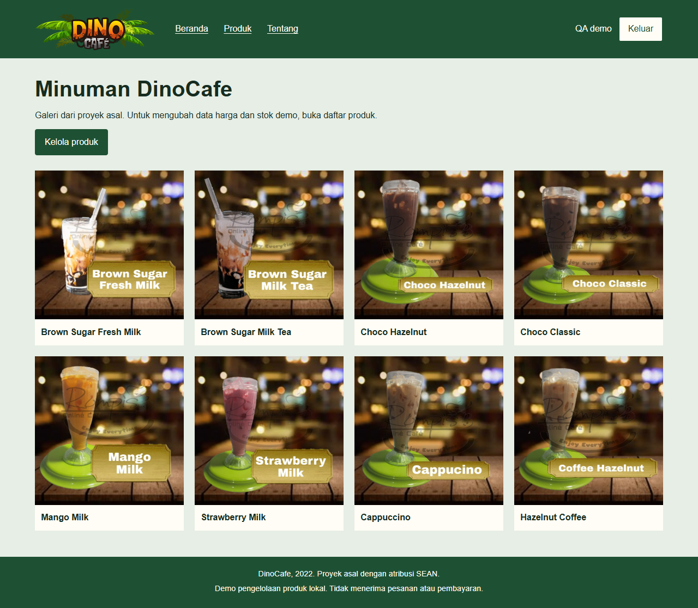
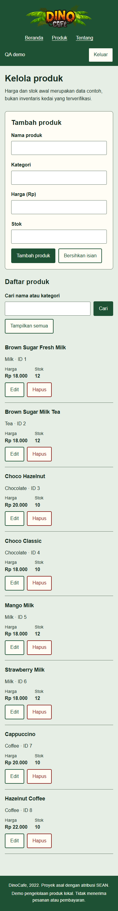

# Cafe Dino Java

Aplikasi latihan pengelolaan produk kafe dengan **Java 17, JSF/Facelets, Hibernate, dan MySQL**. Buat akun demo, masuk, lalu cari, tambah, edit, atau hapus produk beserta harga dan stoknya. Beranda mempertahankan delapan foto minuman dari proyek DinoCafe asal.

Ini aplikasi yang memakai database, bukan halaman login HTML yang bisa dibuka melalui Live Server. Semua akun demo memiliki hak pengelolaan produk yang sama. Tidak ada pesanan, pembayaran, laporan penjualan, atau transaksi pengurangan stok.

## Tampilan aplikasi



Tangkapan aplikasi dari pengujian 25 Oktober 2026 dengan akun, harga, dan stok contoh sintetis. Foto minuman berasal dari proyek asal. Perbaikan backend setelah pengambilan gambar tidak mengubah UI ini.

<details>
<summary>Kelola produk di layar ponsel</summary>



</details>

## Jalankan dengan Docker

Siapkan Docker Desktop dengan Linux containers dan Docker Compose. Dari PowerShell:

```powershell
git clone https://github.com/zalamanga/cafe-dino-java.git
cd cafe-dino-java
Copy-Item .env.example .env
```

Buka `.env`, isi `DB_PASSWORD` dengan password database demo lokal pilihanmu, lalu jalankan:

```powershell
docker compose up --build -d
docker compose ps
```

Buka **http://localhost:18094**. Pilih **Buat akun demo**, gunakan alamat seperti `demo@example.test` dengan password 12 sampai 128 karakter, lalu masuk. Tidak ada akun bawaan atau data pegawai asli. Delapan produk, harga, dan stok awal adalah contoh sintetis untuk mencoba CRUD.

Di Linux/macOS gunakan `cp .env.example .env`. Build pertama mengunduh image dan dependency Maven; tunggu database berstatus `healthy` dan Tomcat selesai memulai. MySQL tidak membuka port ke host; aplikasi hanya diikat ke loopback komputer lokal.

```powershell
docker compose logs --tail=60 web
docker compose down
```

Perintah `down` mempertahankan volume database. Mengedit SQL init hanya berpengaruh ketika volume baru dibuat. Mengganti `DB_PASSWORD` pada `.env` tidak mengubah password pengguna MySQL yang sudah tersimpan; ubah pengguna pada database itu juga sebelum memulai ulang.

## Alur penggunaan

- **Buat akun / masuk:** nama dan email divalidasi di server. Password disimpan sebagai hash PBKDF2-HMAC-SHA256 dengan salt acak, bukan teks asli. Login mengganti ID sesi; halaman internal memerlukan sesi login.
- **Beranda:** galeri delapan minuman asal. Galeri bersifat tetap, sedangkan daftar produk di halaman Produk berasal dari database.
- **Produk:** cari nama atau kategori. Simbol `%` dan `_` diperlakukan sebagai teks pencarian biasa. Harga dan stok harus bilangan bulat tidak negatif.
- **Edit:** pilih baris, ubah form, lalu simpan. Perubahan dari halaman lama ditolak jika versi produk sudah berubah.
- **Hapus:** pilih produk, periksa nama pada konfirmasi, lalu hapus atau batalkan. Database benar-benar berubah.
- **Keluar:** tombol mengirim POST dan mengakhiri sesi server. Membuka halaman internal setelah keluar meminta login kembali.

Form perubahan memakai token CSRF sesi dan view state JSF. Sesi berakhir setelah 30 menit tidak aktif. Lima kegagalan login memberi jeda 30 detik pada sesi tersebut; ini bukan pembatasan terdistribusi atau sistem otorisasi peran.

## Struktur dan build

```text
database/001-schema.sql      Skema pemulihan dan delapan produk contoh
src/main/java/pojo/          Model pegawai dan produk, dipetakan dengan JPA
src/main/java/com/dinocafe/  Hibernate, layanan data, password, filter sesi/CSRF
src/main/java/.../web/       Managed bean JSF
src/main/webapp/             Facelets, CSS/JS lokal, dan aset gambar asal
src/test/java/              Tes password/CSRF dan integrasi ORM dengan H2 terisolasi
pom.xml                     Build Maven menjadi WAR
Dockerfile / compose.yaml   Tomcat 9 dan MySQL 8.4
```

Dengan JDK 17 dan Maven 3.9:

```powershell
mvn verify
```

Hasilnya `target/cafe-dino-java.war`. Untuk menjalankan tanpa Docker, siapkan MySQL dengan `database/001-schema.sql`, lalu atur `DB_URL`, `DB_USER`, dan `DB_PASSWORD` pada **proses Tomcat 9** sebelum deploy WAR. Contoh URL: `jdbc:mysql://localhost:3306/cafe_dino?serverTimezone=UTC`. Buka `http://localhost:8080/cafe-dino-java/` jika nama WAR dan port tetap demikian. `.env` hanya dipakai Compose, tidak otomatis dibaca Tomcat mandiri.

Konfigurasi `.mvn/` memakai endpoint resmi Maven Central `repo1.maven.org`. Konfigurasi itu tidak berisi kredensial dan tidak mematikan pemeriksaan sertifikat TLS.

Mojarra 2.3.21 memakai artifact `org.glassfish:jakarta.faces` tetapi API-nya masih `javax.faces`. Jangan mengganti runtime ke Tomcat 10/11 tanpa migrasi namespace. Hibernate 5.6 dipertahankan agar pemulihan tetap dekat dengan stack asal; seri ini sudah [berakhir dukungan komunitas](https://hibernate.org/orm/releases/5.6/). Aplikasi dibatasi sebagai demo lokal, bukan sistem kedai produksi yang telah diaudit. Penerapan publik memerlukan peninjauan dependency, HTTPS/cookie Secure, pembatasan login lintas sesi, hak akses, backup, dan operasional database.

## Jika ada masalah

- **Port dipakai:** ubah `APP_PORT` di `.env`, kemudian jalankan `docker compose up -d`.
- **Database belum tersedia:** lihat status/log Docker dan cocokkan konfigurasi pengguna. Koneksi yang putus dibuang agar permintaan berikutnya dapat membuka pool baru; setelah database kembali sehat, pilih **Muat ulang**. Transaksi tulis tidak dikirim ulang otomatis. Jika koneksi putus saat menyimpan, periksa daftar sebelum mengirim ulang karena hasil penyimpanan sebelumnya mungkin belum dapat dipastikan.
- **Form kedaluwarsa / 403:** buka ulang halaman dan kirim form baru; jangan memakai form dari sesi yang telah keluar.
- **Tidak ada hasil pencarian:** ubah kata kunci atau pilih **Tampilkan semua**.
- **Perubahan belum tersimpan:** pesan error mempertahankan isian; perbaiki datanya atau muat ulang daftar jika produk diedit dari tab lain.

Tes lama tidak disalin karena melakukan perubahan pada database asal. Tes Maven baru hanya menggunakan H2 dalam memori dengan data sintetis; Docker memberikan verifikasi terpisah pada MySQL.

## Asal dan aset

Dipulihkan dari `CafeDinoProject` berbasis JSF/Hibernate, dengan atribusi **SEAN** pada source dan **DinoCafe, 2022** pada halaman asal. Koneksi hardcoded, data akun, konfigurasi IDE privat, hasil build, dan laporan coverage lama tidak dimasukkan.

Keempat belas gambar sumber dipertahankan identik. Beberapa foto memiliki tanda merek lain dan background lama memiliki watermark; tanda tersebut tidak dihapus. Background itu tidak dipakai sebagai latar UI baru. Asal serta lisensi masing-masing gambar belum tercatat lengkap, sehingga repo tidak memberi lisensi menyeluruh baru atau mengklaim semua aset sebagai karya pemilik akun GitHub.
