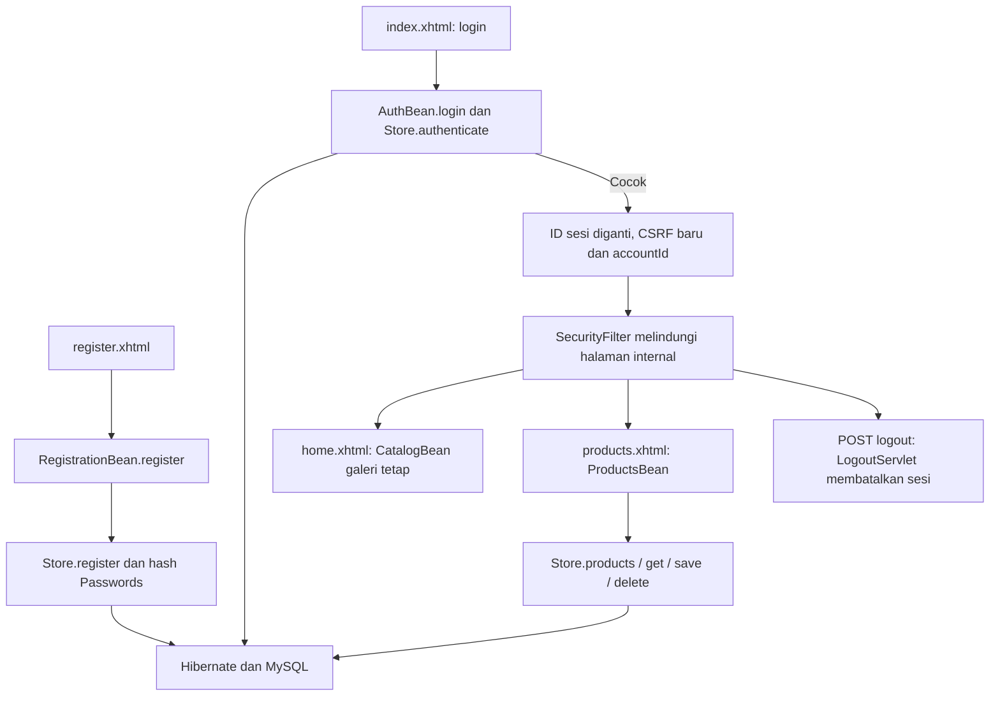

# Alur kode Cafe Dino Java

Cafe Dino mengelola metadata produk, harga, dan stok contoh setelah login. Galeri minuman pada beranda bersifat tetap; daftar Produk berasal dari MySQL. Semua akun demo mempunyai hak pengelolaan yang sama. Tidak ada pesanan, pembayaran, atau pengurangan stok lewat penjualan.

## Registrasi, login, dan sesi

[`RegistrationBean.register()`](../src/main/java/com/dinocafe/web/RegistrationBean.java) memeriksa konfirmasi password sebelum memanggil [`Store.register()`](../src/main/java/com/dinocafe/Store.java). Store menormalkan email, memvalidasi nama/password, memeriksa duplikasi email, dan menyimpan entity `Employees` dengan hash `Passwords`, bukan password teks. Berhasil mendaftar mengarahkan pengguna ke halaman login.

[`AuthBean.login()`](../src/main/java/com/dinocafe/web/AuthBean.java) memanggil `Store.authenticate()` untuk mengambil akun dan memeriksa hash. Login cocok mengganti ID sesi, mengganti token CSRF, dan menyimpan `accountId`. Lima respons kredensial tidak cocok memicu jeda 30 detik pada bean sesi tersebut. Mekanisme ini tidak membatasi percobaan dari sesi/browser lain.

[`SecurityFilter`](../src/main/java/com/dinocafe/SecurityFilter.java) melindungi `home.xhtml`, `products.xhtml`, `about.xhtml`, serta `/logout`. POST non-resource memerlukan token CSRF yang cocok; POST Facelets juga memerlukan parameter JSF ViewState. [`LogoutServlet.doPost()`](../src/main/java/com/dinocafe/LogoutServlet.java) membatalkan sesi dan mengarahkan ke halaman masuk. Tidak ada otorisasi peran admin/editor pada alur ini.

## Galeri dan data produk

[`CatalogBean.getDrinks()`](../src/main/java/com/dinocafe/web/CatalogBean.java) mengembalikan delapan nama/foto minuman tetap untuk `home.xhtml`. Mengubah produk di database tidak mengubah galeri itu.

[`ProductsBean`](../src/main/java/com/dinocafe/web/ProductsBean.java) memuat pencarian dari `q` saat `init()`, kemudian `reload()` memanggil `Store.products()`. Query mencari nama atau kategori dengan parameter. Karakter `%`, `_`, dan escape `!` ditangani sebagai teks biasa, sehingga kata pencarian tidak berubah menjadi pola wildcard bebas.

`edit()` mengambil produk beserta versi ke field form. `save()` memeriksa harga/stok terisi; store memvalidasi nama/kategori, harga 0–1.000.000.000, dan stok 0–1.000.000 sebelum insert/update. Setelah commit, form dibersihkan dan daftar dimuat ulang. Kegagalan menyimpan tidak mengklaim sukses dan meminta pengguna memeriksa daftar sebelum mencoba lagi.

`askDelete()` mengambil produk dan menyimpan ID, versi, serta nama untuk konfirmasi. `cancelDelete()` membatalkan. `delete()` meneruskan ID/versi ke store, lalu membersihkan konfirmasi dan memuat ulang setelah berhasil.

## Transaksi dan pemulihan

`Store.transaction()` membatasi setiap operasi dalam Session dan transaksi Hibernate. Commit dilakukan sebelum hasil dikembalikan; kegagalan memicu percobaan rollback dan penutupan Session. Bila rollback juga gagal, kesalahan kedua disimpan tanpa menutupi kesalahan awal.

[`Product`](../src/main/java/pojo/Product.java) mempunyai `@Version`. Store membandingkan versi saat edit/hapus, dan Hibernate menjaga versi saat commit. Data dari halaman lama tidak boleh diam-diam menimpa produk yang sudah berubah.

[`Database`](../src/main/java/com/dinocafe/Database.java) membaca konfigurasi environment serta memvalidasi schema. Factory yang mengalami kegagalan koneksi dibuang agar permintaan berikutnya dapat membuka koneksi baru. Tidak ada pengiriman ulang tulis otomatis, karena putus koneksi saat commit dapat membuat hasil belum pasti. [`Lifecycle`](../src/main/java/com/dinocafe/Lifecycle.java) menutup factory saat aplikasi dihentikan.

[`database/001-schema.sql`](../database/001-schema.sql) menyediakan schema dan delapan produk sintetis untuk database baru. Harga dan stok merupakan data CRUD contoh, bukan ledger penjualan atau verifikasi ketersediaan layanan nyata.
